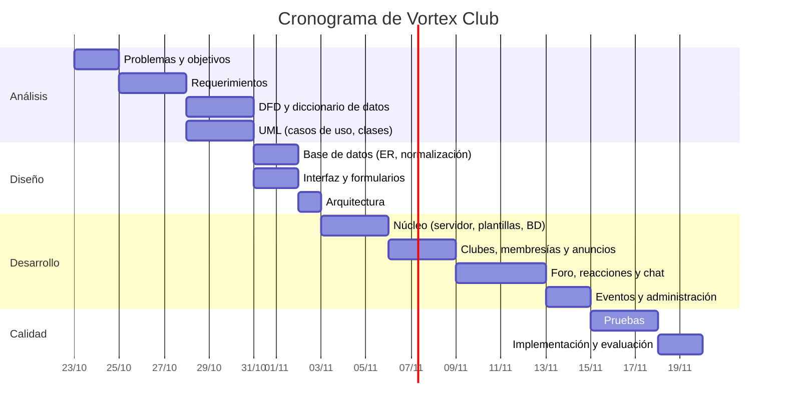

# 1. Planeación del proyecto

> Fase 1 del ciclo de vida del desarrollo de sistemas (CVDS) de Kendall & Kendall:
> *Identificación de problemas, oportunidades y objetivos* (cap. 1 y 3).

## 1.1 Nombre del sistema

**Vortex Club**: plataforma web de clubes estudiantiles de la universidad.

## 1.2 Problema

Hoy los clubes de la universidad se organizan por canales dispersos (grupos de WhatsApp,
páginas de Instagram, carteles en pasillos, correos). Esto provoca que:

| # | Problema observado | Consecuencia |
|---|--------------------|--------------|
| P1 | No existe un lugar único donde ver qué clubes existen. | Los estudiantes no se enteran de los clubes y la participación es baja. |
| P2 | Los anuncios se pierden entre mensajes de chat. | Baja asistencia a reuniones y eventos. |
| P3 | No se sabe quién dirige cada club (líder, capitanes). | Es difícil contactar a la persona correcta. |
| P4 | Proponer un evento se hace de palabra, sin registro. | Ideas que se olvidan, sin trazabilidad de quién aprobó qué. |
| P5 | Las discusiones del club están mezcladas con conversaciones informales. | La información útil no se puede volver a encontrar. |

## 1.3 Oportunidades

- Centralizar en una sola plataforma web, con el mismo estilo sencillo de **UAM Virtual**
  que los estudiantes ya conocen.
- Ofrecer un foro por club estilo **Reddit** (publicaciones, comentarios, votos y reacciones)
  donde las discusiones quedan ordenadas y se pueden buscar.
- Formalizar las propuestas de eventos con un formulario y un flujo de aprobación.

## 1.4 Objetivos

**Objetivo general.** Desarrollar una aplicación web que permita a los estudiantes descubrir,
unirse y participar en los clubes de la universidad, y a los líderes administrarlos.

**Objetivos específicos.**

1. Permitir que cualquier estudiante registrado explore el catálogo de clubes y se una a ellos.
2. Publicar anuncios en dos niveles: **generales** (universidad) y **por club**.
3. Mostrar la estructura de cada club: **líder**, **capitanes** y **miembros**.
4. Recibir y revisar **propuestas de eventos** mediante un formulario.
5. Ofrecer un **chat** por club para conversación en tiempo casi real.
6. Ofrecer un **foro** por club con publicaciones, comentarios anidados, votos y **reacciones**.
7. Construirlo en **Python usando solo la biblioteca estándar** y **SQLite** como base de datos.

## 1.5 Alcance

**Incluye:** registro e inicio de sesión, catálogo y búsqueda de clubes, solicitud de creación de
clubes, membresías y roles, anuncios generales y por club, foro (publicaciones, comentarios,
votos, reacciones, imágenes), chat por club, propuestas de eventos y su aprobación, calendario de
eventos aprobados, perfil de usuario y panel de administración.

**No incluye (versión 1):** aplicación móvil nativa, notificaciones por correo, mensajes directos
entre usuarios, integración con el sistema académico real de la universidad (el CIF se escribe a
mano al registrarse), videollamadas.

## 1.6 Estudio de viabilidad (cap. 3)

### Viabilidad técnica
- Python 3 incluye todo lo necesario: `http.server` (servidor web), `sqlite3` (base de datos),
  `hashlib`/`secrets` (seguridad), `email` (lectura de formularios con archivos), `json`, `html`.
- No requiere instalar dependencias externas ni servidor de base de datos: SQLite es un archivo.
- Corre en cualquier computadora con Python 3.10 o superior (Windows, Linux, macOS).

**Conclusión: viable.**

### Viabilidad económica

| Concepto | Costo |
|----------|-------|
| Lenguaje y librerías (Python estándar) | $0 (software libre) |
| Base de datos (SQLite) | $0 (dominio público) |
| Repositorio (GitHub) | $0 |
| Servidor para piloto (computadora del laboratorio o de un estudiante) | $0 |
| Horas de desarrollo (proyecto académico) | Aportadas por el equipo |

Beneficios intangibles: mayor participación estudiantil, mejor comunicación, registro histórico de
eventos y decisiones. **Conclusión: viable.**

### Viabilidad operativa
- Los usuarios ya manejan plataformas similares (UAM Virtual para lo académico, Reddit/Instagram
  para lo social), por lo que la curva de aprendizaje es baja.
- La administración la hacen los propios líderes de cada club; la universidad solo aprueba la
  creación de clubes y publica anuncios generales.

**Conclusión: viable.**

## 1.7 Metodología de desarrollo

Se sigue el **CVDS de siete fases** de Kendall & Kendall, con iteraciones cortas al programar
(prototipado del cap. 6) para validar las pantallas con usuarios:

1. Identificación de problemas, oportunidades y objetivos → este documento.
2. Determinación de los requerimientos de información → [02_requerimientos.md](02_requerimientos.md).
3. Análisis de las necesidades del sistema → [03_analisis_procesos.md](03_analisis_procesos.md), [04_modelado_uml.md](04_modelado_uml.md).
4. Diseño del sistema recomendado → [05_diseno_base_datos.md](05_diseno_base_datos.md), [06_diseno_interfaz.md](06_diseno_interfaz.md), [07_arquitectura.md](07_arquitectura.md).
5. Desarrollo y documentación del software → código fuente y [manual_usuario.md](manual_usuario.md).
6. Prueba y mantenimiento → [08_pruebas.md](08_pruebas.md).
7. Implementación y evaluación → [09_implementacion.md](09_implementacion.md).

## 1.8 Cronograma (diagrama de Gantt)

## 1.9 Riesgos

| Riesgo | Probabilidad | Impacto | Mitigación |
|--------|-------------|---------|------------|
| Programar sin librerías toma más tiempo | Alta | Medio | Módulos pequeños y reutilizables (enrutador, plantillas) hechos al inicio. |
| SQLite con muchos usuarios simultáneos | Baja (piloto) | Medio | Modo WAL y consultas cortas; migrar a otro motor si crece. |
| Contenido inapropiado en el foro | Media | Medio | Líderes y capitanes pueden eliminar publicaciones; el administrador puede desactivar cuentas. |
| Pérdida de datos | Baja | Alto | Respaldo copiando el archivo `vortex.db`. |
