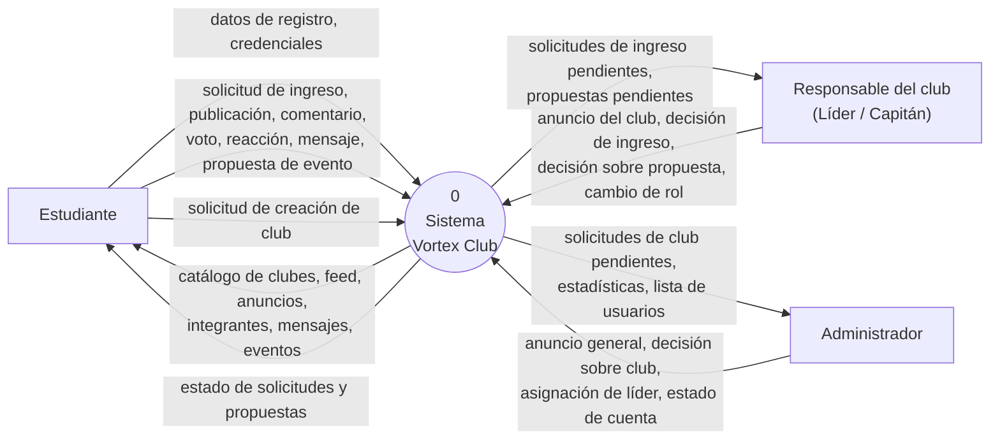
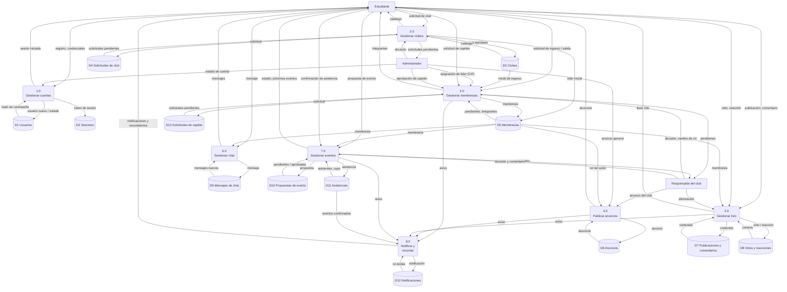
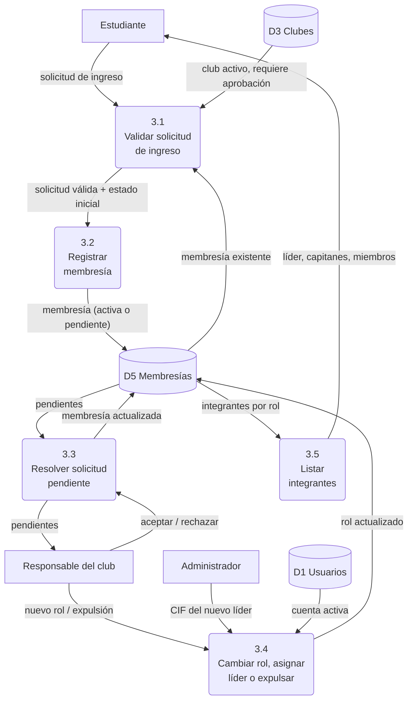
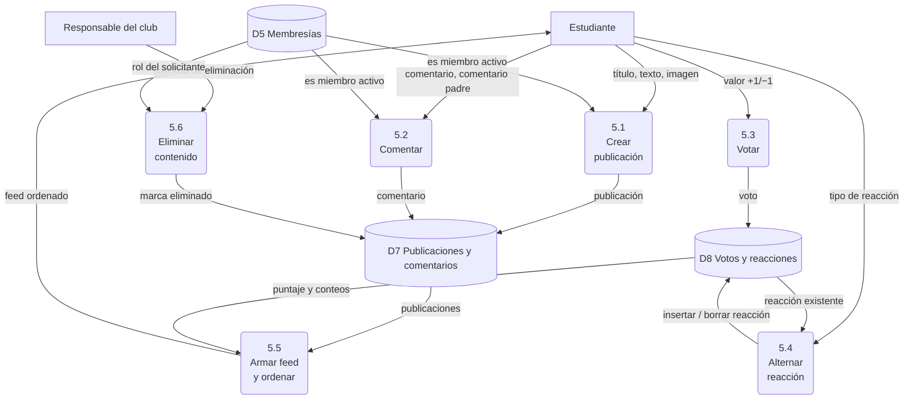
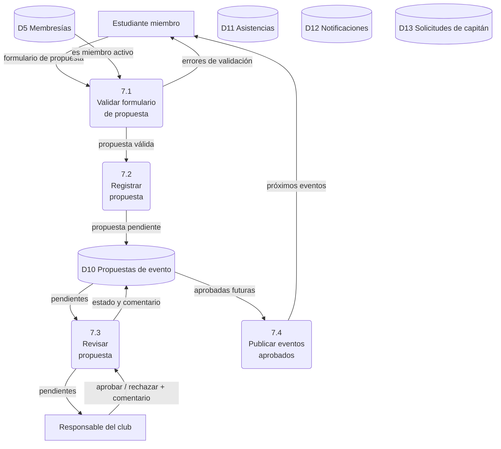
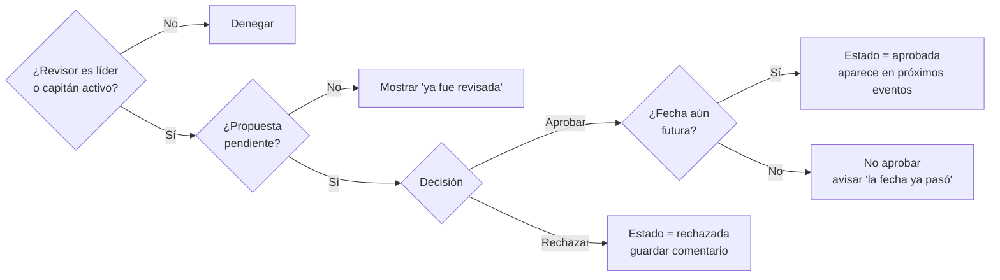

# 3. Análisis de procesos

> Fase 3 del CVDS: *Análisis de las necesidades del sistema*. Diagramas de flujo de datos
> (Kendall, cap. 7), diccionario de datos (cap. 8) y especificación de procesos (cap. 9).

## 3.1 Simbología

Los diagramas se escriben en Mermaid (GitHub los dibuja automáticamente). Se usa la notación de
**Gane y Sarson** adaptada a las figuras disponibles:

| Símbolo Gane & Sarson | Figura en el diagrama | Significado |
|---|---|---|
| Cuadrado doble | Rectángulo `[ ]` | Entidad externa |
| Rectángulo redondeado | Rectángulo redondeado `( )` con número | Proceso |
| Rectángulo abierto | Cilindro `[( )]` con prefijo `D` | Almacén de datos |
| Flecha | Flecha con texto | Flujo de datos |

## 3.2 Diagrama de contexto (nivel superior)



## 3.3 Diagrama de nivel 0



## 3.4 Diagramas hijo (nivel 1)

### 3.4.1 Proceso 3.0, Gestionar membresías



### 3.4.2 Proceso 5.0, Gestionar foro



### 3.4.3 Proceso 7.0, Gestionar eventos



## 3.5 Diccionario de datos

Notación de Kendall (cap. 8): `=` está compuesto de, `+` y, `{ }` repetición, `[ | ]` uno de,
`( )` opcional, `* *` comentario.

### 3.5.1 Flujos de datos

| Nombre | Descripción | Origen | Destino | Estructura |
|--------|-------------|--------|---------|-----------|
| Datos de registro | Datos que escribe un visitante para crear su cuenta | Estudiante | 1.0 | Registro de usuario |
| Credenciales | CIF y contraseña | Estudiante | 1.0 | `CIF + Contraseña` |
| Solicitud de club | Petición para fundar un club | Estudiante | 2.0 | Solicitud de club |
| Solicitud de ingreso | Petición de unirse a un club | Estudiante | 3.0 | `ID usuario + ID club` |
| Publicación | Entrada nueva en el foro | Estudiante | 5.0 | Publicación |
| Reacción | Emoji sobre una publicación | Estudiante | 5.4 | `ID usuario + ID publicación + Tipo reacción` |
| Mensaje | Texto en el chat del club | Estudiante | 6.0 | Mensaje de chat |
| Formulario de propuesta | Datos de un evento propuesto | Estudiante | 7.1 | Propuesta de evento |
| Decisión sobre propuesta | Aprobación o rechazo | Responsable | 7.3 | `ID propuesta + [Aprobada \| Rechazada] + (Comentario)` |
| Anuncio general | Comunicado institucional | Administrador | 4.0 | Anuncio |
| Próximos eventos | Eventos aprobados con fecha futura | 7.4 | Estudiante | `{Evento}` |

### 3.5.2 Almacenes de datos

| ID | Nombre | Descripción | Estructura | Tabla SQLite |
|----|--------|-------------|-----------|--------------|
| D1 | Usuarios | Cuentas registradas | Registro de usuario | `usuarios` |
| D2 | Sesiones | Sesiones abiertas | `Token + ID usuario + Token CSRF + Expira en + Rol de acceso` | `sesiones` |
| D3 | Clubes | Clubes aprobados | Club | `clubes` |
| D4 | Solicitudes de club | Peticiones de nuevos clubes | Solicitud de club | `solicitudes_club` |
| D5 | Membresías | Relación usuario-club con rol | Membresía | `membresias` |
| D6 | Anuncios | Anuncios generales y por club | Anuncio | `anuncios` |
| D7 | Publicaciones y comentarios | Contenido del foro | Publicación, Comentario | `publicaciones`, `comentarios` |
| D8 | Votos y reacciones | Interacciones sobre el contenido | Voto, Reacción | `votos_publicacion`, `votos_comentario`, `reacciones` |
| D9 | Mensajes de chat | Mensajes por club | Mensaje de chat | `mensajes_chat` |
| D10 | Propuestas de evento | Propuestas y su revisión | Propuesta de evento | `propuestas_evento` |
| D11 | Asistencias | Confirmaciones de asistencia a eventos | `ID usuario + ID evento + Fecha` | `asistencias` |
| D12 | Notificaciones | Avisos para cada usuario | `ID usuario + Texto + Enlace + Leída + Fecha` | `notificaciones` |
| D14 | Mensajes privados | Chat entre dos integrantes de un mismo club | `ID emisor + ID receptor + Contenido + Leído + Fecha` | `mensajes_privados` |
| D13 | Solicitudes de capitán | Peticiones de miembros para ser capitán | `ID usuario + ID club + Motivo + Estado + (Revisor + Comentario)` | `solicitudes_capitan` |

### 3.5.3 Estructuras de datos

```text
Registro de usuario = CIF + Nombre completo + Correo + Carrera + Contraseña
                      + (Rol global) + (Activo) + (Fecha de creación)
Club                = ID club + Nombre club + Slug + Descripción + (Foto)
                      + Requiere aprobación + Estado club + Fecha de creación
Solicitud de club   = Nombre club + Descripción + Justificación
                      + Estado solicitud + (Comentario de revisión)
Membresía           = ID usuario + ID club + [Miembro | Capitán | Líder]
                      + [Pendiente | Activa] + Fecha de ingreso
Anuncio             = (ID club) + ID autor + Título + Contenido + Fijado + Fecha
                      * ID club vacío = anuncio general *
Publicación         = ID club + ID autor + Título + Contenido + (Imagen) + Fecha
Comentario          = ID publicación + ID autor + (ID comentario padre) + Contenido + Fecha
Voto                = ID usuario + [ID publicación | ID comentario] + [+1 | −1]
Reacción            = ID usuario + ID publicación + [👍 | ❤️ | 😂 | 😮 | 😢 | 🔥]
Mensaje de chat     = ID club + ID autor + Contenido + Fecha
Propuesta de evento = ID club + ID proponente + Título + Descripción + Fecha inicio
                      + Lugar + (Cupo) + (Recursos) + Estado propuesta
                      + (ID revisor + Comentario de revisión + Fecha de revisión)
```

### 3.5.4 Elementos de datos (selección)

| Elemento | Tipo | Longitud | Formato / validación | Valor por omisión |
|----------|------|---------|---------------------|-------------------|
| CIF | Texto numérico | 8 | Exactamente 8 dígitos; único | — |
| Nombre completo | Texto | 3–80 | Letras y espacios | — |
| Correo | Texto | ≤ 120 | Contiene `@` y un punto en el dominio; único | — |
| Carrera | Texto | ≤ 80 | Lista sugerida | — |
| Contraseña | Texto | 6–128 | Mínimo 6 caracteres; se guarda solo su hash | — |
| Rol global | Texto | — | `estudiante` \| `admin` | `estudiante` |
| Nombre club | Texto | 3–60 | Único | — |
| Slug | Texto | ≤ 70 | Minúsculas, dígitos y guiones, derivado del nombre | — |
| Requiere aprobación | Entero | 1 | 0 = abierto, 1 = con aprobación | 0 |
| Rol en club | Texto | — | `miembro` \| `capitan` \| `lider` | `miembro` |
| Estado membresía | Texto | — | `pendiente` \| `activa` | — |
| Título | Texto | 3–150 | — | — |
| Contenido | Texto | 1–10 000 | — | — |
| Imagen | Texto (ruta) | ≤ 100 | PNG/JPG/GIF/WEBP ≤ 5 MB | vacío |
| Tipo reacción | Texto | — | uno de los 6 emojis permitidos | — |
| Valor voto | Entero | 1 | `1` \| `-1` | — |
| Fecha inicio | Fecha-hora ISO | 16 | `AAAA-MM-DDTHH:MM`, posterior a ahora | — |
| Cupo | Entero | — | 1 – 10 000 | vacío |
| Estado propuesta | Texto | — | `pendiente` \| `aprobada` \| `rechazada` | `pendiente` |

## 3.6 Especificación de procesos (cap. 9)

### 3.6.1 Proceso 3.1/3.2, Unirse a un club (español estructurado)

```text
OBTENER usuario de la sesión
OBTENER club por su slug
SI el club no existe O el club no está activo
    ENTONCES mostrar "Club no encontrado"
DE OTRO MODO
    SI el usuario ya tiene una membresía en el club
        ENTONCES mostrar "Ya eres miembro o tu solicitud está pendiente"
    DE OTRO MODO
        SI el club requiere aprobación
            ENTONCES registrar membresía con rol = miembro, estado = pendiente
                     mostrar "Solicitud enviada; un responsable la revisará"
            DE OTRO MODO registrar membresía con rol = miembro, estado = activa
                     mostrar "Te uniste al club"
        FIN SI
    FIN SI
FIN SI
```

### 3.6.2 Tabla de decisión: ¿quién puede eliminar una publicación?

| Condiciones / Acciones | R1 | R2 | R3 | R4 |
|---|:-:|:-:|:-:|:-:|
| Es el autor de la publicación | S | N | N | N |
| Es líder o capitán activo del club | – | S | N | N |
| Es administrador | – | – | S | N |
| **Permitir eliminar** | X | X | X | |
| **Denegar (error 403)** | | | | X |

### 3.6.3 Árbol de decisión: revisar propuesta de evento



### 3.6.4 Proceso 5.4, Alternar reacción (español estructurado)

```text
OBTENER usuario, publicación y tipo de reacción
SI el tipo no pertenece a {👍, ❤️, 😂, 😮, 😢, 🔥}
    ENTONCES responder error 400
DE OTRO MODO
    SI existe reacción (usuario, publicación, tipo)
        ENTONCES borrarla
        DE OTRO MODO insertarla
    FIN SI
    CALCULAR conteo por tipo para la publicación
    DEVOLVER conteos en formato JSON
FIN SI
```
