# 4. Modelado orientado a objetos con UML

> Kendall, cap. 2 (modelado de casos de uso) y cap. 10 (análisis y diseño orientado a objetos con UML).

## 4.1 Diagrama de casos de uso

UML dibuja actores como monigotes; en Mermaid se representan como rectángulos con 👤 y los casos
de uso como óvalos dentro del límite del sistema. La flecha punteada `«include»` indica que un caso
de uso siempre usa a otro; `«extend»` indica un comportamiento opcional.

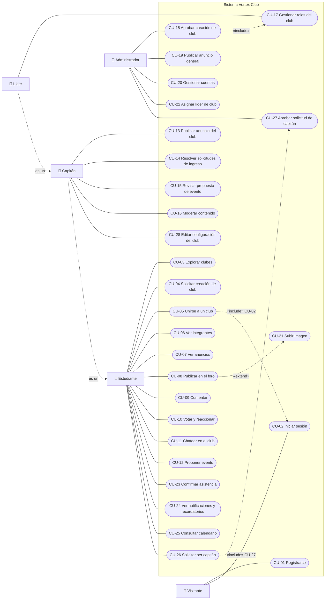

> Generalización: el **Líder** hereda los casos de uso del **Capitán**, y el Capitán los del
> **Estudiante**. CU-18 incluye asignar el rol de líder a quien solicitó el club.

## 4.2 Escenarios de casos de uso

Formato de Kendall (cap. 2): área, actor, interesados, descripción, evento activador, pasos,
precondiciones, postcondiciones, suposiciones, garantías, requerimientos cubiertos.

### CU-05 Unirse a un club

| Campo | Detalle |
|-------|---------|
| **ID** | CU-05 |
| **Prioridad** | Alta |
| **Actor principal** | Estudiante |
| **Interesados** | Estudiante: participar en el club. Líder/capitanes: controlar quién entra. |
| **Descripción** | El estudiante se une a un club abierto o envía una solicitud a un club con aprobación. |
| **Evento activador** | El estudiante pulsa **Unirme** en la página del club. Tipo: externo. |
| **Precondiciones** | Sesión iniciada; el club está activo; el estudiante no tiene membresía en ese club. |

| Pasos | Información para los pasos |
|-------|---------------------------|
| 1. El estudiante abre el catálogo y elige un club. | Lista de clubes (D3) |
| 2. El sistema muestra la página del club con el botón **Unirme**. | Club, conteo de miembros |
| 3. El estudiante pulsa **Unirme**. | Token CSRF |
| 4. El sistema valida que no exista membresía previa. | Membresías (D5) |
| 5a. Si el club es abierto, crea la membresía activa y muestra "Te uniste al club". | Membresía |
| 5b. Si requiere aprobación, crea la membresía pendiente y muestra "Solicitud enviada". | Membresía |

| Campo | Detalle |
|-------|---------|
| **Postcondiciones** | Existe una membresía (activa o pendiente) del estudiante en el club. |
| **Suposiciones** | El estudiante tiene una cuenta activa. |
| **Garantía de éxito** | El estudiante ve el club con su nuevo estado. |
| **Garantía mínima** | Si falla, no se crea ninguna membresía duplicada (restricción `UNIQUE`). |
| **Requerimientos cubiertos** | RF-06, RN-03 |

### CU-08 Publicar en el foro

| Campo | Detalle |
|-------|---------|
| **ID / Prioridad** | CU-08 / Alta |
| **Actor principal** | Miembro activo |
| **Descripción** | El miembro crea una publicación con título, texto e imagen opcional. |
| **Evento activador** | Pulsa **Crear publicación** en el foro del club. |
| **Precondiciones** | Sesión iniciada; membresía activa en el club. |

| Pasos | Información |
|-------|------------|
| 1. El miembro abre el formulario **Crear publicación**. | — |
| 2. Escribe título y contenido; opcionalmente adjunta una imagen. | Formulario multipart |
| 3. El sistema valida longitudes y, si hay imagen, tipo y tamaño. | Reglas RNF-10 |
| 4. Si hay errores, vuelve a mostrar el formulario con los mensajes y lo escrito. | — |
| 5. Si es válido, guarda la imagen en `subidas/` y la publicación en D7. | Publicación |
| 6. Redirige al hilo de la publicación. | — |

| Campo | Detalle |
|-------|---------|
| **Postcondiciones** | La publicación aparece en el foro del club y en el feed de los miembros. |
| **Garantía mínima** | No se guarda una imagen sin su publicación. |
| **Requerimientos cubiertos** | RF-15, RF-21, RNF-08, RNF-10 |

### CU-10 Votar y reaccionar

| Campo | Detalle |
|-------|---------|
| **ID / Prioridad** | CU-10 / Media |
| **Actor principal** | Estudiante |
| **Descripción** | El estudiante vota (+1/−1) o alterna una de las seis reacciones de una publicación. |
| **Evento activador** | Pulsa una flecha de voto, o «Reaccionar» y una reacción. |
| **Precondiciones** | Sesión iniciada; la publicación existe y no está eliminada. |

| Pasos | Información |
|-------|------------|
| 1. El estudiante pulsa ▲, ▼ o una reacción. | Tipo, ID publicación |
| 2. El navegador envía un formulario `POST` normal con el token CSRF y la página de origen. | Formulario |
| 3. El sistema inserta, cambia o elimina el voto o la reacción. | D8 |
| 4. El sistema redirige a la misma página, anclada en la publicación (`#pub-ID`). | Redirección 303 |
| 5. La página se vuelve a generar con Python mostrando los conteos actualizados. | HTML |

| Campo | Detalle |
|-------|---------|
| **Postcondiciones** | Hay como máximo un voto y una reacción de cada tipo por usuario y publicación. |
| **Garantía mínima** | Funciona en cualquier navegador: no usa JavaScript. |
| **Requerimientos cubiertos** | RF-17, RF-18, RN-05, RN-06 |

### CU-12 Proponer evento

| Campo | Detalle |
|-------|---------|
| **ID / Prioridad** | CU-12 / Alta |
| **Actor principal** | Miembro activo |
| **Otros participantes** | Líder o capitán (revisa en CU-15) |
| **Descripción** | El miembro llena el formulario de propuesta de evento. |
| **Evento activador** | Pulsa **Proponer evento** en la pestaña Eventos del club. |
| **Precondiciones** | Membresía activa. |

| Pasos | Información |
|-------|------------|
| 1. El miembro abre el formulario. | — |
| 2. Llena título, descripción, fecha y hora, lugar, cupo y recursos. | Propuesta |
| 3. El sistema valida campos obligatorios, que la fecha sea futura y el cupo numérico. | RN-07 |
| 4. Guarda la propuesta con estado **pendiente**. | D10 |
| 5. Muestra la propuesta en "Mis propuestas" y en la bandeja de los responsables. | — |

| Campo | Detalle |
|-------|---------|
| **Postcondiciones** | Existe una propuesta pendiente asociada al club. |
| **Requerimientos cubiertos** | RF-24, RF-26 |

### CU-15 Revisar propuesta de evento

| Campo | Detalle |
|-------|---------|
| **ID / Prioridad** | CU-15 / Alta |
| **Actor principal** | Capitán o Líder |
| **Descripción** | El responsable aprueba o rechaza una propuesta, con un comentario. |
| **Evento activador** | Abre la bandeja de propuestas pendientes del club. |
| **Precondiciones** | Rol líder o capitán activo; propuesta pendiente. |

| Pasos | Información |
|-------|------------|
| 1. El responsable ve la lista de propuestas pendientes. | D10 |
| 2. Elige **Aprobar** o **Rechazar** y escribe un comentario opcional. | Decisión |
| 3. El sistema verifica permisos y estado (árbol de decisión 3.6.3). | D5, D10 |
| 4. Guarda estado, revisor, comentario y fecha. | D10 |
| 5. Si se aprueba, el evento aparece en el club y en **Próximos eventos**. | — |

| Campo | Detalle |
|-------|---------|
| **Postcondiciones** | La propuesta ya no está pendiente. |
| **Requerimientos cubiertos** | RF-25, RF-27 |

### CU-18 Aprobar creación de club

| Campo | Detalle |
|-------|---------|
| **ID / Prioridad** | CU-18 / Alta |
| **Actor principal** | Administrador |
| **Descripción** | El administrador revisa una solicitud de club y la aprueba o rechaza. |
| **Precondiciones** | Solicitud pendiente; el nombre del club no existe todavía. |

| Pasos | Información |
|-------|------------|
| 1. El administrador abre el panel y ve las solicitudes pendientes. | D4 |
| 2. Pulsa **Aprobar** o **Rechazar** con un comentario. | — |
| 3. Si aprueba: crea el club en D3 y la membresía del solicitante como **líder activo** en D5, en una sola transacción. | D3, D5 |
| 4. Marca la solicitud como revisada. | D4 |

| Campo | Detalle |
|-------|---------|
| **Garantía mínima** | Si falla cualquier paso se deshace todo (transacción). |
| **Requerimientos cubiertos** | RF-05, RN-02, RN-08 |

### CU-23 Confirmar asistencia

| Campo | Detalle |
|-------|---------|
| **ID / Prioridad** | CU-23 / Alta (pedido en la encuesta) |
| **Actor principal** | Estudiante |
| **Descripción** | El estudiante confirma o cancela su asistencia a un evento aprobado. |
| **Precondiciones** | Sesión iniciada; evento aprobado y futuro. |

| Pasos | Información |
|-------|------------|
| 1. Abre el calendario o los eventos del club y pulsa **Confirmar asistencia**. | Evento |
| 2. El sistema verifica que el evento sea futuro y que haya cupo. | D10, D11 |
| 3. Registra la asistencia y vuelve al mismo evento con «Asistirás» y el conteo actualizado. | D11 |
| 4. Si faltan 48 h o menos, el evento aparece como recordatorio en el inicio y en Notificaciones. | — |

| Campo | Detalle |
|-------|---------|
| **Extensión** | 2a. Sin cupo: muestra «El evento ya alcanzó su cupo». 1a. Si ya había confirmado, el botón cancela la asistencia. |
| **Requerimientos cubiertos** | RF-32, RF-34, RN-12 |

### CU-26 / CU-27 Solicitar ser capitán y aprobarlo

| Campo | Detalle |
|-------|---------|
| **Actores** | Miembro (solicita) y Administración (aprueba) |
| **Descripción** | Un miembro pide ser capitán de su club; la administración aprueba o rechaza la petición. |
| **Precondiciones** | Membresía activa con rol miembro; sin otra solicitud pendiente en ese club. |

| Pasos | Información |
|-------|------------|
| 1. En la cabecera del club, el miembro pulsa **Solicitar ser capitán** y escribe un motivo opcional. | Motivo |
| 2. El sistema guarda la solicitud pendiente y notifica a la administración. | D13, D12 |
| 3. La administración revisa la solicitud en su panel y pulsa **Aprobar** o **Rechazar**. | D13 |
| 4. Si aprueba, la membresía pasa a rol capitán; en ambos casos se notifica al miembro. | D5, D12 |

| Campo | Detalle |
|-------|---------|
| **Alternativa** | El líder del club puede nombrar capitanes directamente desde la pestaña Miembros (CU-17). |
| **Requerimientos cubiertos** | RF-37, RN-13 |

## 4.3 Diagramas de actividades

### Unirse a un club

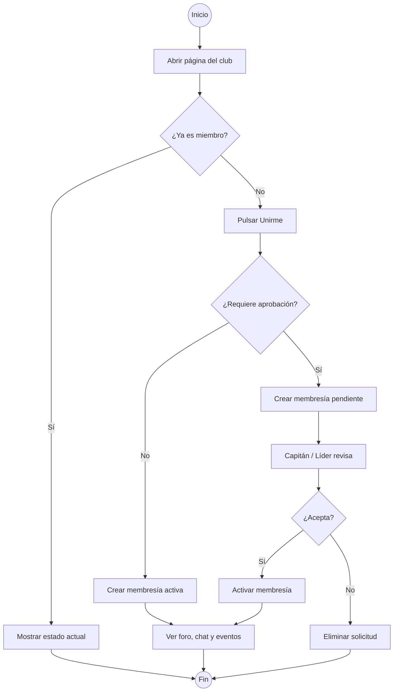

### Proponer y revisar un evento (con carriles)

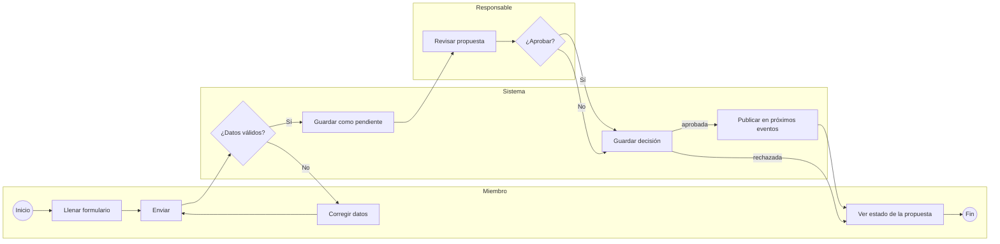

## 4.4 Diagramas de secuencia

### Iniciar sesión

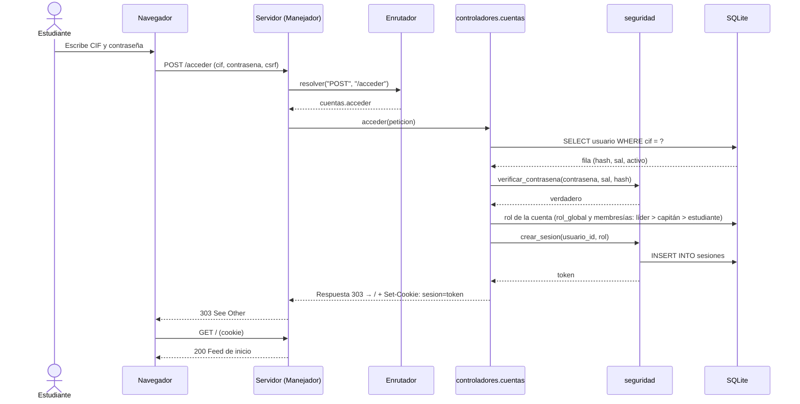

### Alternar una reacción

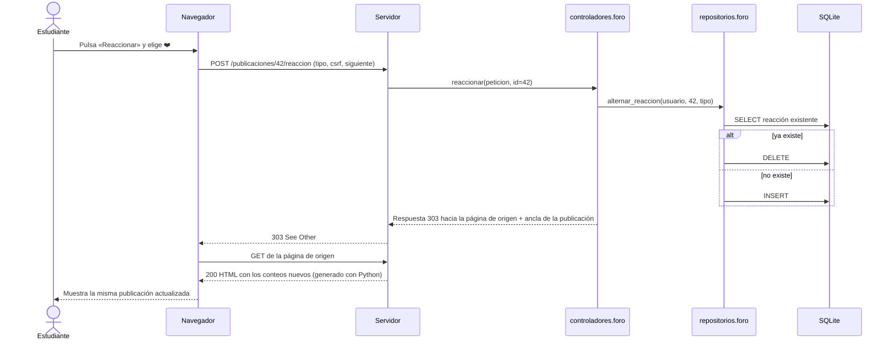

### Chat del club (marco con recarga automática, sin JavaScript)

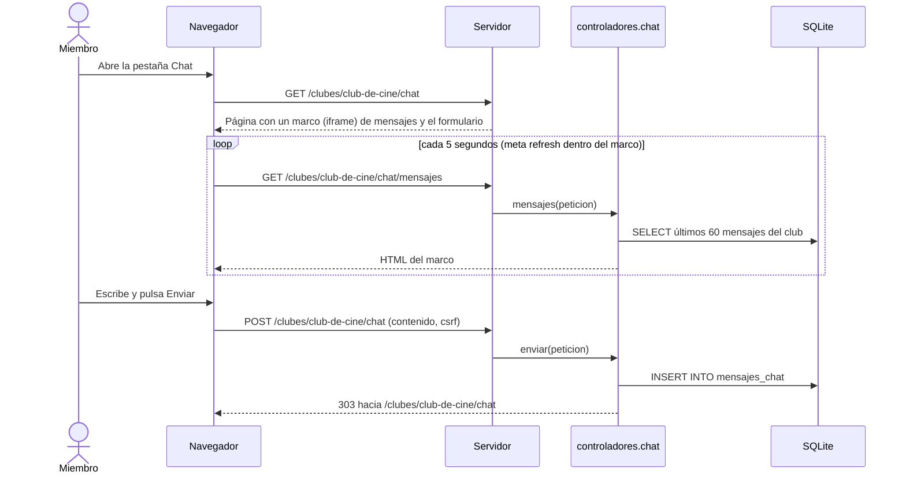

## 4.5 Diagrama de clases

### Clases del dominio (entidades)

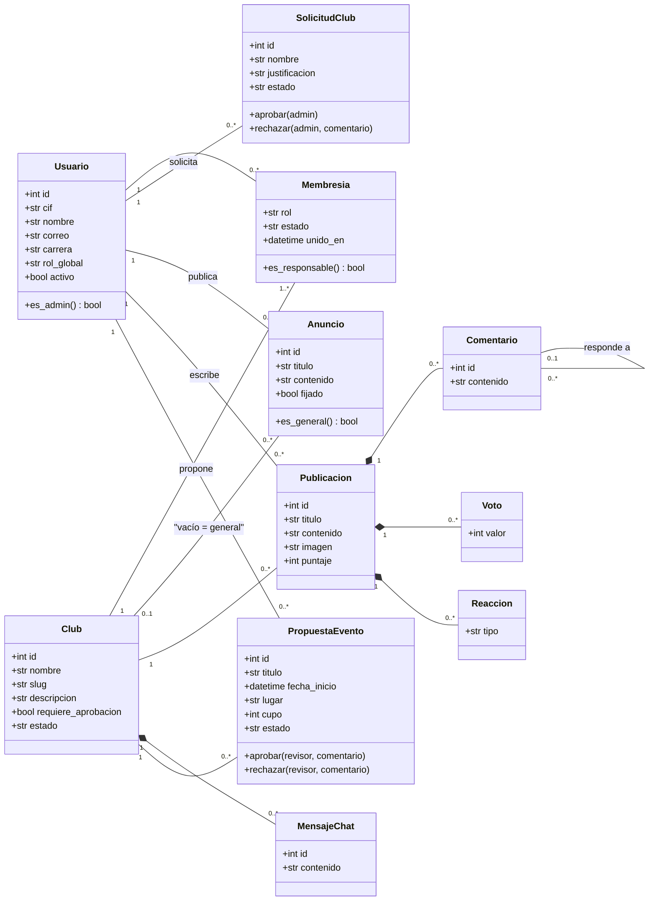

### Clases de la arquitectura (código)

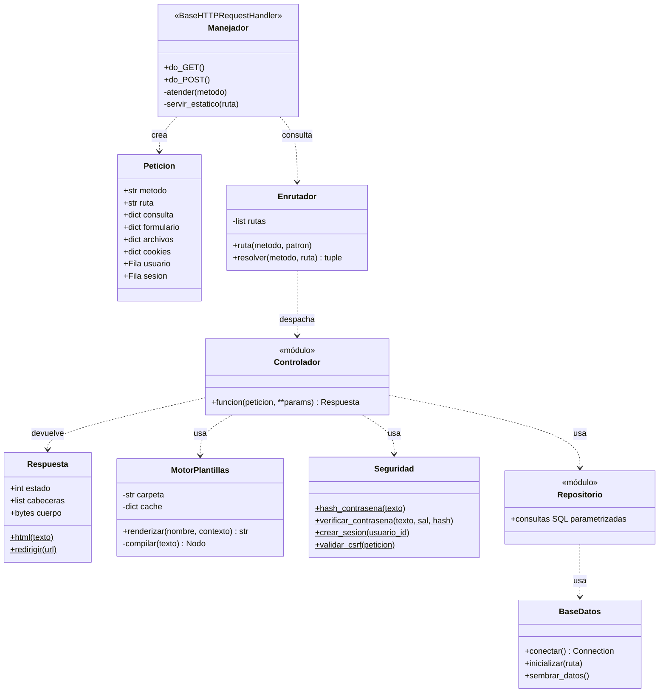

## 4.6 Diagramas de estados

### Membresía

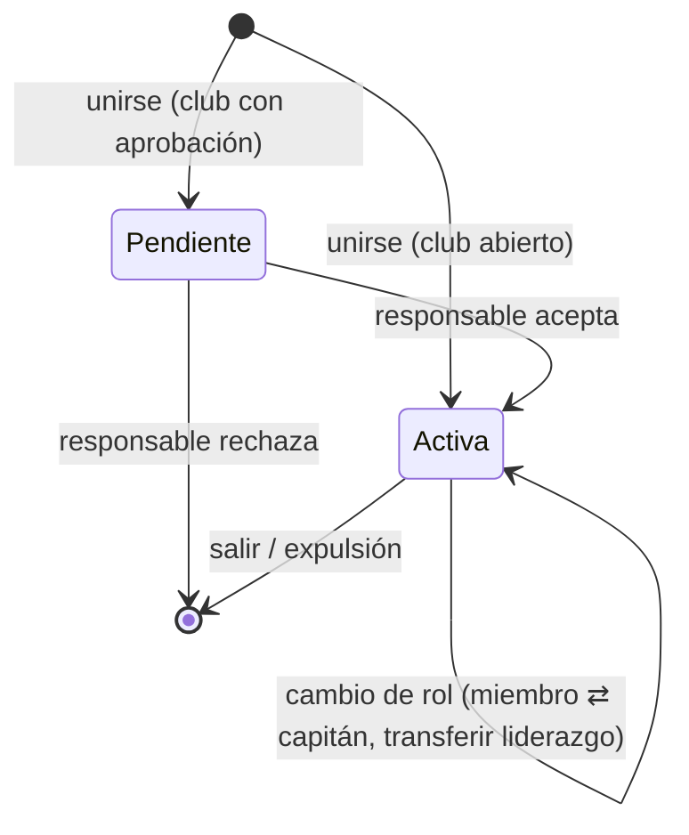

### Propuesta de evento

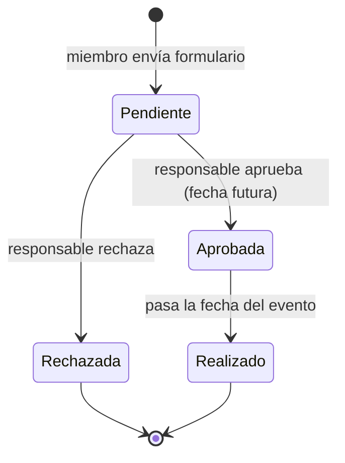

### Solicitud para ser capitán

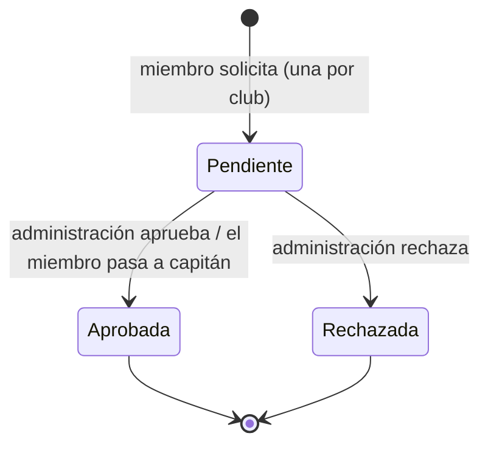

### Asistencia a un evento

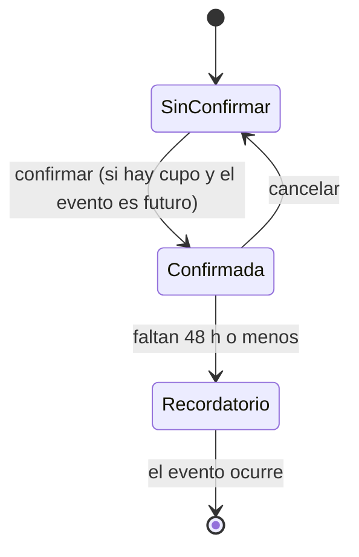

### Solicitud de creación de club

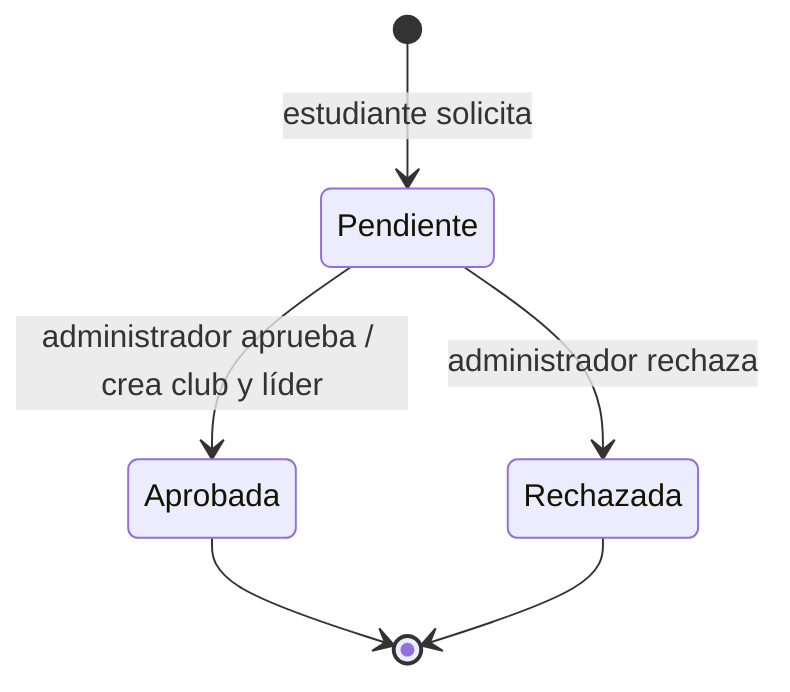
