# 5. Diseño de la base de datos

> Kendall, cap. 13: *Diseño de bases de datos*. Motor: **SQLite 3** mediante el módulo estándar
> `sqlite3` de Python. El script completo está en [`sql/esquema.sql`](../sql/esquema.sql) y se
> ejecuta automáticamente la primera vez que se inicia la aplicación.

## 5.1 Diagrama entidad-relación

Notación pata de gallo: `||` exactamente uno, `o|` cero o uno, `o{` cero o muchos, `|{` uno o muchos.

```mermaid
erDiagram
    USUARIOS ||--o{ SESIONES : "abre"
    USUARIOS ||--o{ ASISTENCIAS : "confirma"
    USUARIOS ||--o{ VOTOS_PROPUESTA : "vota"
    PROPUESTAS_EVENTO ||--o{ VOTOS_PROPUESTA : "recibe"
    PROPUESTAS_EVENTO ||--o{ ASISTENCIAS : "recibe"
    USUARIOS ||--o{ NOTIFICACIONES : "recibe"
    USUARIOS ||--o{ SOLICITUDES_CAPITAN : "pide"
    CLUBES ||--o{ SOLICITUDES_CAPITAN : "recibe"
    USUARIOS ||--o{ MEMBRESIAS : "tiene"
    CLUBES ||--|{ MEMBRESIAS : "agrupa"
    USUARIOS ||--o{ SOLICITUDES_CLUB : "solicita"
    CLUBES |o--o| SOLICITUDES_CLUB : "nace de"
    CLUBES |o--o{ ANUNCIOS : "publica (NULL = general)"
    USUARIOS ||--o{ ANUNCIOS : "escribe"
    CLUBES ||--o{ PUBLICACIONES : "contiene"
    USUARIOS ||--o{ PUBLICACIONES : "escribe"
    PUBLICACIONES ||--o{ COMENTARIOS : "recibe"
    COMENTARIOS |o--o{ COMENTARIOS : "responde a"
    USUARIOS ||--o{ COMENTARIOS : "escribe"
    PUBLICACIONES ||--o{ VOTOS_PUBLICACION : "recibe"
    USUARIOS ||--o{ VOTOS_PUBLICACION : "emite"
    COMENTARIOS ||--o{ VOTOS_COMENTARIO : "recibe"
    USUARIOS ||--o{ VOTOS_COMENTARIO : "emite"
    PUBLICACIONES ||--o{ REACCIONES : "recibe"
    USUARIOS ||--o{ REACCIONES : "da"
    CLUBES ||--o{ MENSAJES_CHAT : "tiene"
    USUARIOS ||--o{ MENSAJES_CHAT : "envía"
    CLUBES ||--o{ PROPUESTAS_EVENTO : "recibe"
    USUARIOS ||--o{ PROPUESTAS_EVENTO : "propone"

    USUARIOS {
        int id PK
        text cif UK "8 dígitos"
        text nombre
        text correo UK
        text carrera
        text foto "archivo en subidas/ o vacío"
        text hash_contrasena "PBKDF2-SHA256"
        text sal
        text rol_global "estudiante | admin"
        int activo
        text creado_en
    }
    SESIONES {
        text token PK
        int usuario_id FK
        text csrf
        text expira_en
        text rol_acceso "estudiante | capitan | lider | admin"
    }
    VOTOS_PROPUESTA {
        int usuario_id PK, FK
        int propuesta_id PK, FK
        int valor "-1 | 1"
    }
    ASISTENCIAS {
        int usuario_id PK, FK
        int evento_id PK, FK
        text creado_en
    }
    NOTIFICACIONES {
        int id PK
        int usuario_id FK
        text texto
        text enlace
        int leida
        text creado_en
    }
    SOLICITUDES_CAPITAN {
        int id PK
        int usuario_id FK
        int club_id FK
        text motivo
        text estado "pendiente | aprobada | rechazada"
        int revisado_por FK
        text comentario
        text creado_en
        text revisado_en
    }
    CLUBES {
        int id PK
        text nombre UK
        text slug UK
        text descripcion
        text foto "archivo en subidas/ o vacío"
        int requiere_aprobacion
        text estado "activo | inactivo"
        text creado_en
    }
    SOLICITUDES_CLUB {
        int id PK
        int usuario_id FK
        text nombre
        text descripcion
        text justificacion
        int requiere_aprobacion
        text estado "pendiente | aprobada | rechazada"
        int revisado_por FK
        text comentario
        int club_id FK
        text creado_en
        text revisado_en
    }
    MEMBRESIAS {
        int id PK
        int usuario_id FK
        int club_id FK
        text rol "miembro | capitan | lider"
        text estado "pendiente | activa"
        text unido_en
    }
    ANUNCIOS {
        int id PK
        int club_id FK "NULL = general"
        int autor_id FK
        text titulo
        text contenido
        int fijado
        text creado_en
    }
    PUBLICACIONES {
        int id PK
        int club_id FK
        int autor_id FK
        text titulo
        text contenido
        text imagen
        int eliminado
        text creado_en
    }
    COMENTARIOS {
        int id PK
        int publicacion_id FK
        int autor_id FK
        int padre_id FK
        text contenido
        int eliminado
        text creado_en
    }
    VOTOS_PUBLICACION {
        int usuario_id PK, FK
        int publicacion_id PK, FK
        int valor "-1 | 1"
    }
    VOTOS_COMENTARIO {
        int usuario_id PK, FK
        int comentario_id PK, FK
        int valor "-1 | 1"
    }
    REACCIONES {
        int usuario_id PK, FK
        int publicacion_id PK, FK
        text tipo PK "emoji"
        text creado_en
    }
    MENSAJES_CHAT {
        int id PK
        int club_id FK
        int autor_id FK
        text contenido
        text creado_en
    }
    PROPUESTAS_EVENTO {
        int id PK
        int club_id FK
        int proponente_id FK
        text titulo
        text descripcion
        text fecha_inicio
        text lugar
        int cupo
        text recursos
        text estado "pendiente | aprobada | rechazada"
        int revisado_por FK
        text comentario_revision
        text creado_en
        text revisado_en
    }
```



## 5.2 Normalización

Se parte de una "planilla" que mezcla todo lo que un club anota hoy a mano, y se lleva a tercera
forma normal (Kendall, cap. 13).

### Forma no normalizada (0FN)

```text
CLUB (nombre_club, descripcion, lider_cif, lider_nombre,
      { miembro_cif, miembro_nombre, miembro_correo, miembro_rol },
      { anuncio_titulo, anuncio_texto, anuncio_fecha },
      { evento_titulo, evento_fecha, evento_lugar, proponente_cif, proponente_nombre })
```

Problemas: grupos repetidos (miembros, anuncios, eventos) y datos del estudiante repetidos en cada
club al que pertenece.

### Primera forma normal (1FN): quitar grupos repetidos

```text
CLUB       (nombre_club, descripcion, lider_cif, lider_nombre)
MIEMBRO    (nombre_club, miembro_cif, miembro_nombre, miembro_correo, miembro_rol)
ANUNCIO    (nombre_club, anuncio_titulo, anuncio_fecha, anuncio_texto)
EVENTO     (nombre_club, evento_titulo, evento_fecha, evento_lugar, proponente_cif, proponente_nombre)
```

### Segunda forma normal (2FN): quitar dependencias parciales

En `MIEMBRO`, con clave `(nombre_club, miembro_cif)`, el nombre y el correo dependen solo de
`miembro_cif`. Se separan:

```text
USUARIO    (cif, nombre, correo)
MEMBRESIA  (nombre_club, cif, rol)
EVENTO     (nombre_club, evento_titulo, evento_fecha, evento_lugar, proponente_cif)
```

### Tercera forma normal (3FN): quitar dependencias transitivas

- En `CLUB`, `lider_nombre` depende de `lider_cif`, no del club → el líder pasa a ser una fila de
  `MEMBRESIA` con `rol = 'lider'`.
- Se agregan **claves sustitutas** (`id INTEGER PRIMARY KEY`) para no usar textos como claves
  foráneas y poder renombrar un club sin romper relaciones.

Resultado: las tablas del diagrama 5.1. Las únicas columnas "derivadas" (el puntaje de una
publicación y la lista de eventos) **no se guardan**: se calculan con las vistas
`v_puntaje_publicacion` y `v_eventos`, así nunca quedan desactualizadas.

## 5.3 Diccionario de tablas

| Tabla | Clave primaria | Claves foráneas | Restricciones relevantes |
|-------|---------------|-----------------|--------------------------|
| `usuarios` | `id` | — | `cif` único de 8 dígitos (`CHECK`), `correo` único sin distinguir mayúsculas, `rol_global ∈ {estudiante, admin}` |
| `sesiones` | `token` | `usuario_id → usuarios` | Se borra en cascada con el usuario; `rol_acceso` guarda el rol elegido al iniciar sesión |
| `clubes` | `id` | — | `nombre` y `slug` únicos, `estado ∈ {activo, inactivo}`, `foto` opcional |
| `solicitudes_club` | `id` | `usuario_id`, `revisado_por`, `club_id` | `estado ∈ {pendiente, aprobada, rechazada}` |
| `membresias` | `id` | `usuario_id`, `club_id` | `UNIQUE(usuario_id, club_id)`; índice único parcial: **un solo líder por club** (RN-02) |
| `anuncios` | `id` | `club_id` (nulo = general), `autor_id` | título de 3 a 150 caracteres |
| `publicaciones` | `id` | `club_id`, `autor_id` | `eliminado` lógico (0/1) |
| `comentarios` | `id` | `publicacion_id`, `autor_id`, `padre_id → comentarios` | relación recursiva para hilos |
| `votos_publicacion` | `(usuario_id, publicacion_id)` | ambos | `valor ∈ {-1, 1}`: un voto por persona (RN-06) |
| `votos_comentario` | `(usuario_id, comentario_id)` | ambos | `valor ∈ {-1, 1}` |
| `reacciones` | `(usuario_id, publicacion_id, tipo)` | ambos | `tipo` ∈ 6 emojis: una reacción de cada tipo por persona (RN-05) |
| `mensajes_chat` | `id` | `club_id`, `autor_id` | 1 a 1000 caracteres |
| `propuestas_evento` | `id` | `club_id`, `proponente_id`, `revisado_por` | `cupo` entre 1 y 10 000, `estado ∈ {pendiente, aprobada, rechazada}` |
| `votos_propuesta` | `(usuario_id, propuesta_id)` | ambos | `valor ∈ {-1, 1}`: un voto por miembro y propuesta (RN-14) |
| `asistencias` | `(usuario_id, evento_id)` | ambos | Una confirmación por persona y evento; el cupo se valida en el servidor (RN-12) |
| `notificaciones` | `id` | `usuario_id` | `leida ∈ {0, 1}`; índice por usuario y estado de lectura |
| `solicitudes_capitan` | `id` | `usuario_id`, `club_id`, `revisado_por` | Índice único parcial: una sola solicitud **pendiente** por persona y club (RN-13) |

## 5.4 Índices y vistas

| Objeto | Propósito |
|--------|-----------|
| `ux_un_lider_por_club` | Índice único parcial `WHERE rol = 'lider'`: impide dos líderes en un club. |
| `ix_membresias_club` | Listar integrantes y pendientes de un club. |
| `ix_publicaciones_club` | Foro del club ordenado por fecha. |
| `ix_mensajes_club` | Consulta del chat "mensajes con id mayor que N". |
| `ix_propuestas_club` | Bandeja de pendientes y próximos eventos. |
| `v_eventos` | Propuestas aprobadas de clubes activos. |
| `v_puntaje_publicacion` | Suma de votos de cada publicación. |
| `ux_capitan_pendiente` | Índice único parcial: una solicitud de capitán pendiente por persona y club. |
| `ix_notificaciones` | Bandeja y contador de no leídas de cada usuario. |
| `ix_asistencias_evento` | Conteo de confirmados por evento. |

## 5.5 Decisiones de diseño

- **Fechas como texto ISO 8601** (`AAAA-MM-DD HH:MM:SS`): SQLite no tiene tipo fecha, y el texto
  ISO se ordena y compara correctamente.
- **Eliminación lógica** en publicaciones y comentarios: un hilo no se rompe si se borra un
  comentario intermedio; se muestra "[eliminado]".
- **`PRAGMA foreign_keys = ON`** en cada conexión, porque SQLite las trae desactivadas.
- **Modo WAL** (`PRAGMA journal_mode = WAL`) para que lecturas y escrituras simultáneas no se
  bloqueen entre sí.
- **Transacciones** en operaciones de varios pasos: aprobar un club (crear club + líder + marcar
  solicitud) y transferir liderazgo.
- **Sin categorías:** la clasificación de clubes por categorías se retiró. En bases creadas con
  versiones anteriores, al iniciar se reconstruyen `clubes` y `solicitudes_club` sin la columna
  `categoria_id` (SQLite no permite borrar una columna con clave foránea) y se borra `categorias`.
- **Migración automática:** al iniciar, si la base de datos es de una versión anterior y a la
  tabla `sesiones` le falta la columna `rol_acceso`, se agrega con `ALTER TABLE` (las tablas nuevas
  se crean solas con `CREATE TABLE IF NOT EXISTS`).
- **Respaldo:** basta con copiar el archivo `datos/vortex.db` con el servidor detenido.
