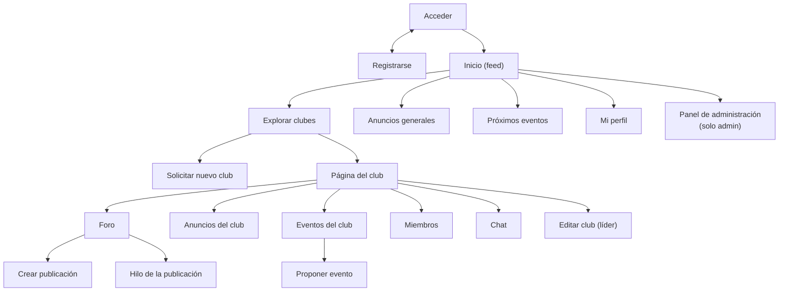

# 6. Diseño de la interfaz, la salida y la entrada

> Kendall, cap. 11 (*Diseño de una salida efectiva*), cap. 12 (*Diseño de una entrada efectiva*),
> cap. 14 (*Interacción humano-computadora*) y cap. 15 (*Procedimientos precisos de entrada de datos*).

## 6.1 Referentes visuales

| Referente | Qué se toma |
|-----------|-------------|
| **UAM Virtual** (pantalla de acceso) | Tarjeta blanca centrada sobre fondo, logotipo arriba, campos con ícono a la izquierda, botón ancho verde azulado "Acceder", recuadro celeste de ayuda "¿Qué hacer si no puedes acceder?", tipografía redondeada sin serifa. Usuario = **CIF**. |
| **Reddit** (foro) | Barra superior con buscador y botón **Crear**, menú lateral izquierdo (Inicio, Explorar, Crear comunidad), feed central de tarjetas con "r/club • hace 12 h", título grande, imagen, botón **Unirse**, votos y comentarios. |

Se combinan así: **la identidad visual es la de UAM Virtual** (colores, tarjetas, acceso) y **la
estructura del foro es la de Reddit**.

## 6.2 Guía de estilo

| Elemento | Valor |
|----------|-------|
| Color primario | `#1497A6` (verde azulado del botón "Acceder") |
| Primario oscuro (hover) | `#0E7C89` |
| Color de acento suave | `#E8F4FB` (recuadro de ayuda) |
| Texto principal | `#1F2937` |
| Texto secundario | `#6B7280` |
| Fondo de la app | `#F3F6F8` |
| Tarjetas | `#FFFFFF`, borde `#E5E7EB`, radio 10 px, sombra muy suave |
| Error / éxito | `#DC2626` / `#16A34A` |
| Tipografía | `Poppins`, con respaldo `"Segoe UI", system-ui, sans-serif` (sin descargar fuentes) |
| Íconos | Emojis y SVG en línea (sin librerías de íconos) |
| Modo oscuro | Automático según el sistema operativo (`prefers-color-scheme`) |

## 6.3 Principios de interacción humano-computadora aplicados

1. **Ajuste tarea-usuario:** las tres tareas más frecuentes (ver feed, entrar a un club,
   publicar) están a un clic desde el menú lateral.
2. **Consistencia:** todas las páginas de club comparten la misma cabecera y pestañas
   (Foro · Anuncios · Eventos · Miembros · Chat).
3. **Retroalimentación:** cada acción muestra un mensaje breve ("Te uniste al club",
   "Propuesta enviada"); los votos y reacciones cambian al instante.
4. **Prevención de errores:** acciones destructivas (eliminar, expulsar, salir) piden
   confirmación; los botones que el usuario no puede usar no se muestran.
5. **Carga cognitiva baja:** máximo 6 campos por formulario; etiquetas siempre visibles.
6. **Accesibilidad:** contraste AA, etiquetas `<label>` en todos los campos, navegación con
   teclado, textos alternativos en imágenes.

## 6.4 Mapa de navegación



## 6.5 Prototipos de pantalla (wireframes)

### Acceder (estilo UAM Virtual)

```text
┌──────────────────────────── fondo degradado verde azulado ───────────────────────────┐
│                         ┌──────────────────────────────┐                             │
│                         │        ( ◉ ) VORTEX CLUB      │                             │
│                         │     Clubes estudiantiles UAM  │                             │
│                         │                               │                             │
│                         │  Bienvenido/a. Inicia sesión  │                             │
│                         │  con tu CIF para ver tus      │                             │
│                         │  clubes.                      │                             │
│                         │ ┌───────────────────────────┐ │                             │
│                         │ │ 👤  CIF                    │ │                             │
│                         │ └───────────────────────────┘ │                             │
│                         │ ┌───────────────────────────┐ │                             │
│                         │ │ 🔑  Contraseña          👁 │ │                             │
│                         │ └───────────────────────────┘ │                             │
│                         │ [         Acceder           ] │                             │
│                         │ ┌───────────────────────────┐ │                             │
│                         │ │ ¿No tienes cuenta?         │ │                             │
│                         │ │ • Regístrate con tu CIF    │ │                             │
│                         │ └───────────────────────────┘ │                             │
│                         └──────────────────────────────┘                             │
└──────────────────────────────────────────────────────────────────────────────────────┘
```

### Inicio (estilo Reddit, colores UAM)

```text
┌─────────────────────────────────────────────────────────────────────────────────────┐
│ ◉ Vortex Club     [ 🔍 Buscar clubes...              ]        [+ Crear]  Carlos ▾   │
├───────────────┬───────────────────────────────────────────────┬─────────────────────┤
│ 🏠 Inicio      │ ┌───────────────────────────────────────────┐ │ 📢 Anuncios generales│
│ 🧭 Explorar    │ │ c/robotica • Ana López • hace 2 h          │ │ • Feria de clubes   │
│ 📢 Anuncios    │ │ Taller de Arduino este viernes             │ │   15/11             │
│ 📅 Eventos     │ │ [ imagen ]                                 │ │ • Cierre de solic.  │
│ ＋ Crear club   │ │ ▲ 12 ▼   💬 4   👍3 ❤️2 🔥1  [+😊]          │ │                     │
│ ─────────────  │ └───────────────────────────────────────────┘ │ 📅 Próximos eventos │
│ MIS CLUBES     │ ┌───────────────────────────────────────────┐ │ • 08/11 Hackatón    │
│ 🤖 Robótica     │ │ c/ajedrez • ...                            │ │                     │
│ ♟ Ajedrez       │ └───────────────────────────────────────────┘ │                     │
└───────────────┴───────────────────────────────────────────────┴─────────────────────┘
```

### Página del club

```text
┌───────────────────────────────────────────────────────────────┐
│ [R]  Robótica                                   [ Unirme ]    │
│      Tecnología · 24 miembros · Abierto                       │
│      Construimos robots y competimos...                       │
├───────────────────────────────────────────────────────────────┤
│  Foro | Anuncios | Eventos | Miembros | Chat                  │
├───────────────────────────────────────────────────────────────┤
│  Ordenar: (Nuevos) Populares            [ + Crear publicación ]│
│  ...tarjetas de publicaciones...                              │
└───────────────────────────────────────────────────────────────┘
```

### Miembros

```text
 LÍDER        👑 Ana López (Ing. en Sistemas)
 CAPITANES    ⭐ Luis Pérez         [Quitar capitán] (solo líder)
 MIEMBROS     • María Ruiz         [Nombrar capitán] [Expulsar]
 PENDIENTES   • Jorge Díaz         [Aceptar] [Rechazar]   (líder/capitán)
```

### Chat

```text
┌───────────────────────────────────────────────┐
│ Ana López  10:02                              │
│ ¿Quién trae el cautín mañana?                 │
│                         Luis Pérez  10:03     │
│                               Yo lo llevo 👍   │
├───────────────────────────────────────────────┤
│ [ Escribe un mensaje...              ] [Enviar]│
└───────────────────────────────────────────────┘
```

## 6.6 Diseño de la salida

| Salida | Medio | Contenido | Orden |
|--------|-------|-----------|-------|
| Feed de inicio | Pantalla | Publicaciones de mis clubes con club, autor, fecha relativa, título, extracto, imagen, puntaje, comentarios y reacciones | Más recientes primero |
| Foro del club | Pantalla | Igual que el feed, filtrado por club | Nuevos o Populares (puntaje) |
| Anuncios | Pantalla | Título, autor, fecha, texto; insignia 📌 si está fijado | Fijados primero, luego fecha |
| Integrantes | Pantalla | Agrupados por rol con nombre y carrera | Líder, capitanes, miembros (alfabético) |
| Próximos eventos | Pantalla | Fecha destacada tipo calendario, título, club, lugar, cupo | Fecha ascendente |
| Panel admin | Pantalla | Totales (usuarios, clubes, publicaciones, eventos), solicitudes pendientes, tabla de usuarios | — |
| Chat | Pantalla, actualización cada 3 s | Autor, hora, mensaje; mis mensajes alineados a la derecha | Cronológico |
| Conteos de reacciones / puntaje | JSON (para la página) | `{"puntaje": 12}` / `{"conteos": {"👍": 3}}` | — |

## 6.7 Diseño de la entrada (formularios)

| Formulario | Campos (tipo HTML) | Obligatorios |
|-----------|--------------------|-------------|
| Registro | CIF (`text`, `inputmode=numeric`, `maxlength=8`), nombre (`text`), correo (`email`), carrera (`text` + `datalist`), contraseña (`password`), confirmar (`password`) | Todos |
| Acceder | CIF, contraseña | Todos |
| Solicitar club | Nombre, categoría (`select`), descripción (`textarea`), justificación (`textarea`), ¿requiere aprobación? (`checkbox`) | Nombre, categoría, descripción |
| Crear publicación | Título, contenido (`textarea`), imagen (`file`, `accept=image/*`) | Título |
| Comentario | Contenido (`textarea`), padre (oculto) | Contenido |
| Anuncio | Título, contenido, fijar (`checkbox`) | Título, contenido |
| Propuesta de evento | Título, descripción, fecha y hora (`datetime-local`), lugar, cupo (`number`), recursos (`textarea`) | Título, descripción, fecha, lugar |
| Revisión de propuesta | Decisión (botón Aprobar / Rechazar), comentario | Decisión |
| Mensaje de chat | Contenido (`text`, `maxlength=1000`) | Contenido |

Todos los formularios que modifican datos llevan el campo oculto `csrf` y usan el método `POST`.

## 6.8 Procedimientos de validación de entrada (cap. 15)

Se valida **dos veces**: en el navegador (atributos `required`, `maxlength`, `type`) para dar
retroalimentación rápida, y **siempre en el servidor**, que es la validación que cuenta.

| Prueba de Kendall | Dónde se aplica |
|-------------------|-----------------|
| Prueba de existencia (campo vacío) | Todos los campos obligatorios |
| Prueba de longitud | CIF = 8, nombre 3–80, título 3–150, mensaje ≤ 1000, contenido ≤ 10 000 |
| Prueba de clase / composición | CIF solo dígitos; cupo entero; correo con `@` y dominio con punto |
| Prueba de rango | Cupo 1–10 000; fecha del evento posterior a ahora; valor de voto ∈ {−1, 1} |
| Prueba de valores no válidos | Rol ∈ {miembro, capitán, líder}; reacción ∈ 6 emojis; categoría existente |
| Prueba de referencias cruzadas | Contraseña = confirmación; CIF y correo no registrados; nombre de club no repetido |
| Verificación de archivo | Imagen ≤ 2 MB y firma binaria de PNG, JPEG, GIF o WEBP |

Cuando hay errores, el formulario se vuelve a mostrar **con lo que el usuario escribió** y un
mensaje junto a cada campo con problema, para no obligarlo a escribir todo de nuevo.
