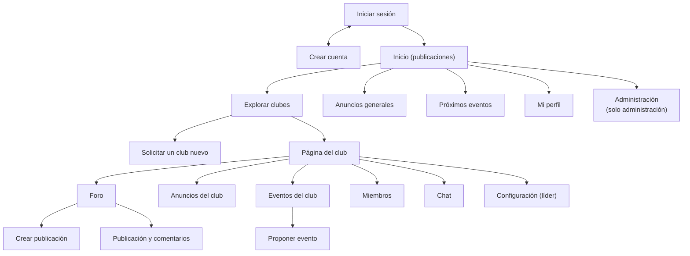

# 6. Diseño de la interfaz, la salida y la entrada

> Kendall, cap. 11 (*Diseño de una salida efectiva*), cap. 12 (*Diseño de una entrada efectiva*),
> cap. 14 (*Interacción humano-computadora*) y cap. 15 (*Procedimientos precisos de entrada de datos*).

## 6.1 Referentes visuales

| Referente | Qué se toma |
|-----------|-------------|
| **UAM Virtual** (pantalla de acceso) | Formulario en una caja blanca, usuario = **CIF**, botón ancho "Acceder", recuadro de ayuda debajo del formulario, color verde azulado institucional. |
| **Reddit** (foro) | Barra superior con buscador, menú lateral izquierdo, lista de publicaciones con columna de votos a la izquierda, metadatos «club · autor · hace 2 h», comentarios anidados. |

Se combinan así: **la sobriedad e identidad institucional de UAM Virtual** y **la estructura
del foro de Reddit**, con un acabado formal: líneas rectas, bordes finos y sin adornos.

## 6.2 Guía de estilo

| Elemento | Valor |
|----------|-------|
| Logotipo | Monograma **VC** (Vortex Club's) trazado en SVG: cuadrado color UAM `#009AA9` con letras blancas (`estatico/img/logo.svg`) y versión en contorno blanco para fondos oscuros (`logo-blanco.svg`) |
| Color de marca | **`#009AA9`** (verde azulado institucional de la UAM); hover `#007A87`; profundo `#005C66`; fondo suave `#E1F5F7`; acento cálido `#F2B33D` para niveles y el lema |
| Texto | Títulos `#14212B`, texto `#27343E`, secundario `#5E6C78` |
| Fondo y tarjetas | Fondo `#F2F4F6`; tarjetas blancas **sin borde**, con sombra sutil y esquinas de **12 px**; botones y campos con esquinas de 8 px |
| Estados | Peligro `#A8261C`, éxito `#1D6B45`, pendiente `#7A5300`, siempre con su fondo claro |
| Tipografía | **Una sola familia sans-serif**: Inter, Poppins o Roboto si están instaladas, con respaldo en Segoe UI / system-ui (no se descargan fuentes). Sin cursivas ni fuentes clásicas: el contraste se logra solo con grosores (800, 700, 600, 400) |
| Rótulos de sección | Mayúsculas pequeñas con espaciado amplio (p. ej. «ANUNCIOS GENERALES») |
| Íconos y emojis | **Ninguno** en títulos, menús ni botones. Los únicos emojis visibles son las seis reacciones del foro, porque son el contenido de esa función |
| Tema | Claro, único, para mantener una apariencia uniforme |
| Menú lateral | El ítem activo usa el color principal al 10 % de opacidad y una línea de acento vertical a la izquierda |
| Filtros | Control segmentado: pista gris clara compartida y opción activa en blanco con sombra suave |
| Banner de bienvenida | Degradado del verde UAM a un tono más oscuro, con un brillo suave y una trama de puntos muy tenue |
| Estados vacíos | Ícono minimalista en gris claro dentro de un círculo (publicaciones, calendario, anuncios, notificaciones, personas) más un texto que explica qué aparecerá ahí |
| Fondo del acceso | Foto de la entrada de la Universidad Americana (`estatico/img/campus-uam.jpg`) bajo un velo en el color UAM y una trama fina de líneas diagonales; la foto se acerca muy despacio |
| Identidad UAM | Lema del afiche de Vida Estudiantil «Sé parte de un club» en el acceso; «Universidad Americana (UAM) · Managua, Nicaragua · Dirección de Vida Estudiantil · I Semestre 2026» en el pie; carreras de la UAM en el registro; los 14 clubes oficiales |
| Movimiento | Animaciones pequeñas de CSS: entrada escalonada de paneles y publicaciones, elevación al pasar el cursor, menús que se despliegan suavemente, campana que se mueve y contador que late cuando hay notificaciones, barra de cupo que se llena. Se desactivan si el sistema pide «reducir movimiento» |
| Cabecera | Logotipo, campana de notificaciones con contador y menú de cuenta con el tipo de usuario (Estudiante, Capitán, Líder o Administración). **Sin barra de búsqueda** (la búsqueda queda en el catálogo de clubes) |
| JavaScript | **Ninguno.** Todo se resuelve con HTML generado por Python y CSS |

## 6.3 Principios de interacción humano-computadora aplicados

1. **Ajuste tarea-usuario:** las tareas más frecuentes (ver publicaciones, entrar a un club,
   publicar) están a un clic desde el menú lateral.
2. **Consistencia:** todas las páginas de club comparten la misma cabecera y las mismas pestañas
   (Foro · Anuncios · Eventos · Miembros · Chat · Configuración).
3. **Retroalimentación:** cada acción muestra un aviso breve ("Te uniste al club",
   "Propuesta enviada"); al votar o reaccionar la página vuelve exactamente a la misma publicación
   (ancla `#pub-ID`) con el contador actualizado.
4. **Prevención de errores:** acciones destructivas (eliminar, expulsar, salir, desactivar) piden
   confirmación con un recuadro desplegable `<details>` (sin JavaScript); los botones que el
   usuario no puede usar no se muestran.
5. **Carga cognitiva baja:** formularios cortos, etiquetas siempre visibles, ayudas bajo el campo.
6. **Accesibilidad:** contraste AA, `<label>` en todos los campos, foco visible al navegar con
   teclado, textos alternativos en imágenes.

## 6.4 Mapa de navegación



## 6.5 Prototipos de pantalla (wireframes)

### Iniciar sesión

```text
┌──────────────────────────────┬───────────────────────────────────────────────┐
│ [VC] Vortex Club's · UAM     │                                               │
│ (panel #009AA9)              │      ┌─────────────────────────────────┐      │
│ VIDA ESTUDIANTIL · I SEM 2026│      │ Iniciar sesión                  │      │
│                              │      │ CIF         [_______________]   │      │
│                              │      │ Contraseña  [_______________]   │      │
│ ─ Catálogo e inscripción     │      │ [            Acceder          ] │      │
│ ─ Anuncios generales y club  │      │ ┃ ¿No tienes cuenta? Crea una   │      │
│ ─ Foros, chat y eventos      │      │ ┃ ¿Olvidaste tu contraseña? ... │      │
│                              │      └─────────────────────────────────┘      │
│ COMUNIDAD UNIVERSITARIA      │                                               │
└──────────────────────────────┴───────────────────────────────────────────────┘
```

### Inicio

```text
┌──────────────────────────────────────────────────────────────────────────────────┐
│ [VC] Vortex Club's                                  [campana 2]  [AL] Ana · Líder│
├───────────────┬────────────────────────────────────────────┬─────────────────────┤
│ GENERAL       │ ┌ Buenas tardes, Ana ─ clubes 2 · confirmados 1 ┐│ PRÓXIMOS EVENTOS    │
│ ┃ Inicio      │ └ puntos 15 · nivel Participante ─────────────┘│ [08 NOV] Título     │
│   Explorar    │ ───────────────────────────────────────────│ Fijado · hace 2 h   │
│   Anuncios    │ [Recientes|Populares]                      │ Ver todos           │
│   Eventos     │ ┌──┬──────────────────────────────────────┐├─────────────────────┤
│ GESTIÓN       │ │▲ │ Club de Cine · Publicado por … · 3 h │ │ PRÓXIMOS EVENTOS    │
│   Crear club  │ │3 │ Título de la publicación             │ │ [08 NOV] Título     │
│ MIS CLUBES    │ │▼ │ Extracto…                            │ │ Ver calendario      │
│   Club de Cine│ │  │ 2 comentarios  👍 1  Reaccionar      │ │                     │
│               │ └──┴──────────────────────────────────────┘│                     │
└───────────────┴────────────────────────────────────────────┴─────────────────────┘
```

### Página del club

```text
┌───────────────────────────────────────────────────────────────┐
│ [CC]  ARTE Y CULTURA                          [Unirme al club]│
│       Club de Cine                                            │
│       0 miembros · Ingreso abierto                            │
├───────────────────────────────────────────────────────────────┤
│  Foro   Anuncios   Eventos   Miembros   Chat   Configuración  │
│  ━━━━                                                         │
└───────────────────────────────────────────────────────────────┘
```

### Miembros (tabla)

```text
 INTEGRANTE          CARRERA        ROL         (acciones solo para el líder)
 Ana López           Sistemas       LÍDER
 Luis Pérez          Sistemas       CAPITÁN     Quitar capitán · Transferir liderazgo · Expulsar
 María Ruiz          Diseño         MIEMBRO     Nombrar capitán · Transferir liderazgo · Expulsar
```

### Chat

```text
┌───────────────────────────────────────────────┐
│ CHAT DEL CLUB                    Solo miembros│
│ ┌───────────────────────────────────────────┐ │  ← marco que se recarga
│ │ Ana López 10:02                           │ │    solo cada 5 segundos
│ │ ¿Quién trae el cautín mañana?             │ │
│ │                      Luis Pérez 10:03     │ │
│ │                           Yo lo llevo.    │ │
│ └───────────────────────────────────────────┘ │
│ [ Escribe un mensaje...              ] [Enviar]│
└───────────────────────────────────────────────┘
```

## 6.6 Diseño de la salida

| Salida | Medio | Contenido | Orden |
|--------|-------|-----------|-------|
| Bienvenida | Pantalla | Saludo según la hora, fecha, número de clubes, eventos confirmados, puntos y nivel | — |
| Recordatorios | Banda amarilla en inicio y Notificaciones | Eventos confirmados que empiezan en 48 h o menos | Fecha ascendente |
| Notificaciones | Pantalla y contador en la campana | Texto con enlace y fecha relativa; las no leídas resaltadas | Más recientes primero |
| Calendario | Rejilla mensual (lunes a domingo) | Eventos por día; los confirmados en color sólido | Por día |
| Ranking | Panel lateral | Los 5 estudiantes con más puntos y su nivel | Puntos descendente |
| Inicio | Pantalla | Publicaciones de mis clubes con club, autor, fecha relativa, título, extracto, imagen, puntaje, comentarios y reacciones | Recientes o Populares |
| Foro del club | Pantalla | Igual que el inicio, filtrado por club | Recientes o Populares (puntaje + reacciones + comentarios) |
| Anuncios | Pantalla | Título, autor, fecha, texto; rótulo «Fijado» | Fijados primero, luego fecha |
| Integrantes | Tabla | Nombre, carrera, rol y fecha de ingreso | Líder, capitanes, miembros (alfabético) |
| Próximos eventos | Pantalla | Bloque de fecha (día y mes), título, hora, lugar, cupo, club | Fecha ascendente |
| Administración | Pantalla y tablas | Totales (usuarios, clubes, publicaciones, eventos), solicitudes pendientes, tabla de clubes con asignación de líder, tabla de usuarios | — |
| Chat | Marco con recarga automática cada 5 s | Autor, hora y mensaje; los propios a la derecha | Cronológico, el más nuevo abajo |
| Estado vacío | Pantalla | Mensaje sobrio y acción sugerida («Aún no perteneces a ningún club» + Explorar clubes) | — |

## 6.7 Diseño de la entrada (formularios)

| Formulario | Campos (tipo HTML) | Obligatorios |
|-----------|--------------------|-------------|
| Crear cuenta | CIF (`text`, `inputmode=numeric`, `maxlength=8`), nombre, correo (`email`), carrera (`text` + `datalist`), contraseña y confirmación (`password`) | Todos menos carrera |
| Iniciar sesión | CIF, contraseña (el tipo de usuario se determina por la cuenta) | Todos |
| Solicitar club | Nombre, categoría (`select`), descripción (`textarea`), justificación (`textarea`), ¿requiere aprobación? (`checkbox`) | Nombre, categoría, descripción |
| Crear publicación | Título, texto (`textarea`), imagen (`file`) | Título |
| Comentario / respuesta | Contenido (`textarea`), padre (oculto) | Contenido |
| Anuncio | Título, contenido, fijar (`checkbox`) | Título, contenido |
| Propuesta de evento | Nombre, descripción, fecha y hora (`datetime-local`), lugar, cupo (`number`), recursos | Nombre, descripción, fecha, lugar |
| Revisión de propuesta | Decisión (Aprobar / Rechazar), comentario | Decisión |
| Asignar líder (administración) | CIF del estudiante | CIF |
| Mensaje de chat | Contenido (`text`, `maxlength=1000`) | Contenido |

Todos los formularios que modifican datos usan `POST` y llevan el campo oculto `csrf`.

## 6.8 Procedimientos de validación de entrada (cap. 15)

Se valida **dos veces**: en el navegador con atributos HTML (`required`, `maxlength`, `type`), que
no requieren JavaScript, y **siempre en el servidor con Python**, que es la validación que cuenta.

| Prueba de Kendall | Dónde se aplica |
|-------------------|-----------------|
| Prueba de existencia (campo vacío) | Todos los campos obligatorios |
| Prueba de longitud | CIF = 8, nombre 3–80, título 3–150, mensaje ≤ 1000, contenido ≤ 10 000 |
| Prueba de clase / composición | CIF solo dígitos; cupo entero; correo con `@` y dominio con punto |
| Prueba de rango | Cupo 1–10 000; fecha del evento posterior a ahora; valor de voto ∈ {−1, 1} |
| Prueba de valores no válidos | Rol ∈ {miembro, capitán, líder}; reacción ∈ 6 emojis; categoría existente |
| Prueba de referencias cruzadas | Contraseña = confirmación; CIF y correo no registrados; nombre de club no repetido; CIF del líder existente y activo |
| Verificación de archivo | Imagen ≤ 2 MB y firma binaria de PNG, JPEG, GIF o WEBP |

Cuando hay errores, el formulario se vuelve a mostrar **con lo que el usuario escribió**, el campo
con problema resaltado en rojo y el mensaje debajo.
