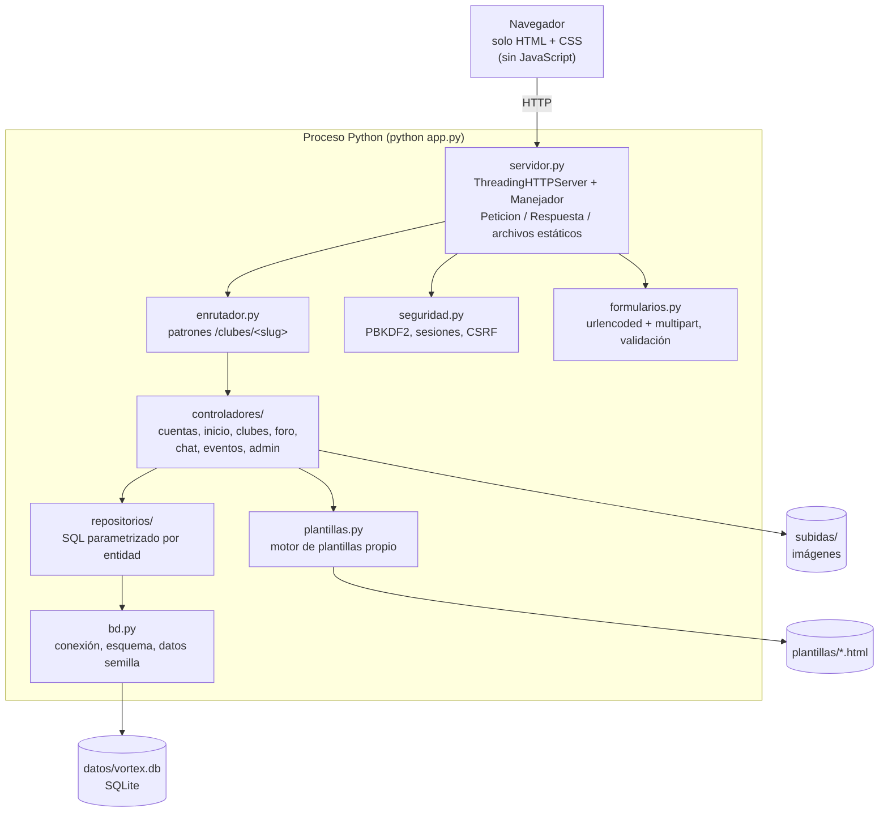

# 7. Arquitectura del software

> Diseño del sistema recomendado (fase 4 del CVDS). Restricción principal: **Python 3 con la
> biblioteca estándar únicamente** y **SQLite**. Todo lo que normalmente haría un framework
> (servidor, enrutamiento, plantillas, sesiones, formularios) está programado a mano.

## 7.1 Vista general por capas



Es un patrón **Modelo-Vista-Controlador** sencillo:

- **Modelo:** `repositorios/` + `bd.py` (todo el SQL vive aquí).
- **Vista:** `plantillas/*.html` + `plantillas.py`.
- **Controlador:** `controladores/`, una función por ruta, que recibe una `Peticion` y devuelve una `Respuesta`.

## 7.2 Módulos de la biblioteca estándar utilizados

| Módulo | Uso |
|--------|-----|
| `http.server` | `ThreadingHTTPServer` y `BaseHTTPRequestHandler`: servidor web multihilo |
| `sqlite3` | Base de datos |
| `hashlib`, `secrets`, `hmac` | Hash de contraseñas (PBKDF2), tokens de sesión y CSRF, comparación segura |
| `http.cookies` | Lectura de cookies (las `Set-Cookie` se arman a mano con `HttpOnly` y `SameSite=Lax`) |
| `urllib.parse` | Rutas, parámetros y formularios `application/x-www-form-urlencoded` |
| `email.parser` | Lectura de formularios `multipart/form-data` (subida de imágenes) |
| `html` | Escapado de texto (prevención de XSS) |
| `re`, `datetime`, `os`, `pathlib`, `mimetypes`, `threading`, `unicodedata` | Utilidades |
| `unittest` | Pruebas automáticas |

## 7.3 Estructura de carpetas

```text
Vortex_club/
├── app.py                  ← punto de entrada: python app.py
├── vortex/
│   ├── config.py           ← rutas, límites y constantes (ajustables con variables de entorno)
│   ├── nucleo.py           ← Fila, ErrorHttp, Peticion, Respuesta
│   ├── servidor.py         ← Manejador HTTP (http.server), archivos estáticos, cabeceras de seguridad
│   ├── enrutador.py        ← Enrutador con parámetros en la ruta (<slug>, <id>)
│   ├── plantillas.py       ← motor de plantillas propio
│   ├── vistas.py           ← render(): contexto común (usuario, CSRF, avisos) + páginas de error
│   ├── acceso.py           ← decoradores de sesión/admin y permisos por club
│   ├── bd.py               ← conexión SQLite, creación del esquema
│   ├── semilla.py          ← datos iniciales (admin, categorías) y datos de ejemplo
│   ├── seguridad.py        ← contraseñas PBKDF2, sesiones, CSRF, límite de intentos
│   ├── formularios.py      ← lectura urlencoded/multipart y validaciones
│   ├── utilidades.py       ← slugs, fechas relativas, iniciales
│   ├── repositorios/       ← usuarios, clubes, anuncios, foro, chat, eventos, notificaciones, participacion (todo el SQL)
│   └── controladores/      ← cuentas, inicio, clubes, foro, chat, eventos, admin
├── plantillas/             ← HTML (base, páginas y parciales/)
├── estatico/               ← css/estilo.css, img/logo.svg (monograma VC), img/logo-blanco.svg
├── sql/esquema.sql         ← definición de la base de datos
├── datos/                  ← vortex.db (se crea sola, no se sube a GitHub)
├── subidas/                ← imágenes de publicaciones (no se suben a GitHub)
├── pruebas/                ← pruebas automáticas con unittest
├── referencias/            ← (solo local, no se sube) PDF de Kendall y capturas de UAM Virtual / Reddit
└── docs/                   ← esta documentación
```

## 7.4 Ciclo de una petición

1. `Manejador.do_GET/do_POST` arma un objeto `Peticion` (ruta, consulta, cookies, formulario).
2. Si la ruta empieza con `/estatico/` o `/subidas/` se sirve el archivo directamente
   (bloqueando `..` para evitar salir de la carpeta).
3. Se busca la sesión por la cookie `sesion` y se carga el usuario.
4. En peticiones `POST` se valida el token CSRF; si falla → 403.
5. El `Enrutador` encuentra la función del controlador y los parámetros (`slug`, `id`).
6. El controlador verifica permisos, usa los repositorios y devuelve una `Respuesta`
   (HTML renderizado o redirección 303).
7. Cualquier excepción no controlada se registra en consola y se muestra una página 500 amigable.

### Cookies que usa la aplicación

| Cookie | Contenido | Duración |
|--------|-----------|----------|
| `sesion` | Token aleatorio de la sesión (se compara con la tabla `sesiones`) | 7 días |
| `csrf_anon` | Token CSRF para formularios de visitantes (acceso y registro) | 30 días |
| `aviso` | Mensaje de una sola lectura («Te uniste al club») | 60 segundos |

## 7.5 Interfaz sin JavaScript

Por requisito del proyecto el navegador no ejecuta ningún código: todo lo genera Python en el
servidor. Así se resuelve cada parte interactiva:

| Necesidad | Solución solo con HTML/CSS + Python |
|-----------|-------------------------------------|
| Votar y reaccionar | Formulario `POST` por botón; el servidor guarda el cambio y redirige (303) a la misma página con el ancla `#pub-ID`, de modo que el usuario vuelve a la publicación que estaba viendo |
| Menú de reacciones, menú de usuario, «Responder» | Elementos nativos `<details>`/`<summary>`, que se abren y cierran sin código |
| Confirmar acciones destructivas | `<details class="confirmar">`: al pulsar «Eliminar» se despliega la pregunta y el botón definitivo |
| Chat que se actualiza solo | La página del chat incrusta un marco (`<iframe>`) con los mensajes; ese marco trae `<meta http-equiv="refresh" content="5">` y se vuelve a pedir cada 5 segundos. Con `flex-direction: column-reverse` los mensajes más nuevos quedan abajo y visibles |
| Validación inmediata | Atributos HTML (`required`, `maxlength`, `type="email"`, `min`/`max`); la validación definitiva siempre es la del servidor |

Para permitir el marco del chat la cabecera `X-Frame-Options` es `SAMEORIGIN` y la política de
contenido incluye `frame-ancestors 'self'` (solo el propio sitio puede enmarcar sus páginas).

## 7.6 Motor de plantillas propio

Sintaxis soportada (inspirada en Jinja, pero mínima):

| Sintaxis | Significado |
|----------|-------------|
| `{{ expresion }}` | Imprime el valor **escapado** |
| `{{ expresion \| seguro }}` | Imprime sin escapar (solo HTML generado por el sistema) |
| ` …  …  … ` | Condicional |
| ` …  … ` | Repetición, con bloque si la lista está vacía |
| `` y ` … ` | Herencia de plantillas |
| `` | Inclusión |

El texto se divide con una expresión regular en fragmentos, se construye un árbol de nodos y se
guarda en caché. Las expresiones se evalúan con un entorno restringido (sin funciones
integradas de Python), sobre los datos que entrega el controlador.

## 7.7 Rutas

| Método | Ruta | Controlador | Acceso |
|--------|------|-------------|--------|
| GET/POST | `/acceder` | cuentas.acceder | Visitante |
| GET/POST | `/registro` | cuentas.registro | Visitante |
| POST | `/salir` | cuentas.salir | Sesión |
| GET | `/` | inicio.feed | Sesión |
| GET | `/perfil/<cif>` | cuentas.perfil | Sesión |
| GET/POST | `/anuncios` | inicio.anuncios_generales | Sesión / Admin para publicar |
| POST | `/anuncios/<id>/eliminar` | inicio.eliminar_anuncio | Autor, responsable o admin |
| GET | `/eventos?mes=AAAA-MM&vista=mios` | eventos.proximos (calendario mensual) | Sesión |
| POST | `/eventos/<id>/asistencia` | eventos.asistencia (confirmar / cancelar) | Sesión |
| GET | `/notificaciones` | inicio.ver_notificaciones | Sesión |
| GET | `/gestion` | inicio.gestion (clubes a mi cargo) | Capitán / Líder / Admin |
| POST | `/clubes/<slug>/solicitar-capitan` | clubes.solicitar_capitan | Miembro |
| POST | `/perfil/foto` · `/perfil/foto/quitar` | cuentas.cambiar_foto · cuentas.quitar_foto | Sesión |
| POST | `/clubes/<slug>/foto` · `/clubes/<slug>/foto/quitar` | clubes.cambiar_foto_club · clubes.quitar_foto_club | Responsable |
| GET | `/clubes` | clubes.catalogo | Sesión |
| GET/POST | `/clubes/solicitar` | clubes.solicitar | Sesión |
| GET | `/clubes/<slug>` | foro.foro_club | Sesión |
| POST | `/clubes/<slug>/unirse` | clubes.unirse | Sesión |
| POST | `/clubes/<slug>/salir` | clubes.salir | Miembro |
| GET/POST | `/clubes/<slug>/editar` | clubes.editar | Líder |
| GET/POST | `/clubes/<slug>/anuncios` | clubes.anuncios | Sesión / Responsable para publicar |
| GET | `/clubes/<slug>/miembros` | clubes.miembros | Sesión |
| POST | `/clubes/<slug>/miembros/<id>` | clubes.gestionar_miembro | Responsable / Líder |
| GET | `/clubes/<slug>/eventos` | eventos.eventos_club | Sesión |
| GET/POST | `/clubes/<slug>/eventos/proponer` | eventos.proponer | Miembro |
| POST | `/propuestas/<id>/revisar` | eventos.revisar | Responsable |
| POST | `/propuestas/<id>/votar` | eventos.votar_propuesta: en propuestas pendientes vota el miembro (aprobación automática al alcanzar el umbral); en eventos aprobados cualquier estudiante vota «Me interesa» para posicionarlo | Miembro / Sesión |
| GET | `/clubes/<slug>/chat` | chat.sala | Miembro |
| GET | `/clubes/<slug>/chat/mensajes` | chat.mensajes (HTML del marco, se recarga cada 5 s) | Miembro |
| POST | `/clubes/<slug>/chat` | chat.enviar | Miembro |
| GET/POST | `/clubes/<slug>/publicar` | foro.publicar | Miembro |
| GET | `/publicaciones/<id>` | foro.hilo | Sesión |
| POST | `/publicaciones/<id>/comentar` | foro.comentar | Miembro |
| POST | `/publicaciones/<id>/votar` | foro.votar_publicacion | Sesión |
| POST | `/publicaciones/<id>/reaccion` | foro.reaccionar | Sesión |
| POST | `/publicaciones/<id>/eliminar` | foro.eliminar_publicacion | Autor / Responsable / Admin |
| POST | `/comentarios/<id>/votar` | foro.votar_comentario | Sesión |
| POST | `/comentarios/<id>/eliminar` | foro.eliminar_comentario | Autor / Responsable / Admin |
| GET | `/admin` | admin.panel | Admin |
| POST | `/admin/solicitudes/<id>` | admin.resolver_solicitud | Admin |
| POST | `/admin/usuarios/<id>` | admin.cambiar_estado_usuario | Admin |
| POST | `/admin/clubes/<id>` | admin.cambiar_estado_club | Admin |
| POST | `/admin/clubes/<id>/lider` | admin.asignar_lider | Admin |
| POST | `/admin/capitanes/<id>` | admin.resolver_solicitud_capitan | Admin |

## 7.8 Modelo de permisos

El **tipo de usuario lo determina la cuenta**: no se elige al iniciar sesión.
`seguridad.rol_de_cuenta` lo calcula en cada petición: «admin» si `rol_global = 'admin'`; si no,
«lider» o «capitan» si tiene ese rol en algún club activo; si no, «estudiante». Así, un nombramiento
nuevo se aplica de inmediato. `vortex/acceso.py` concentra las reglas:

| Función | Devuelve verdadero cuando… |
|---------|----------------------------|
| `es_admin(p)` | la cuenta es de administración (permiso total) |
| `modo_gestion(p)` | la cuenta es líder o capitán de algún club |
| `es_responsable_en(p, club)` | es administración, o es líder o capitán activo de **ese** club |
| `es_lider_en(p, club)` | es administración, o es el líder de **ese** club |
| `exigir_miembro(p, club)` | es miembro activo o administración; si no, error 403 |

Un estudiante (o un líder en un club que no es el suyo) solo puede eliminar lo que él mismo publicó.

## 7.9 Seguridad

| Amenaza | Medida |
|---------|--------|
| Robo de contraseñas | PBKDF2-HMAC-SHA256, sal de 16 bytes, 200 000 iteraciones; comparación con `hmac.compare_digest` |
| Secuestro de sesión | Token de 32 bytes (`secrets.token_urlsafe`), cookie `HttpOnly; SameSite=Lax`, expiración de 7 días, borrado al salir |
| CSRF | Token por sesión en el campo oculto `csrf` de cada formulario `POST` |
| Ejecución de scripts | No hay JavaScript; además la cabecera `Content-Security-Policy` usa `script-src 'none'`, así ningún script inyectado podría ejecutarse |
| XSS | El motor de plantillas escapa todo por defecto; los textos de usuario nunca se marcan como `seguro` |
| Inyección SQL | Siempre consultas con `?` (parámetros), nunca concatenación |
| Recorrido de carpetas | Las rutas estáticas se resuelven y se verifica que queden dentro de su carpeta |
| Archivos maliciosos | Lista blanca de tipos por firma binaria, tamaño máximo 5 MB, nombre aleatorio generado por el servidor |
| Cuerpos enormes | Límite de 6 MB por petición (imagen de hasta 5 MB más el formulario) |
